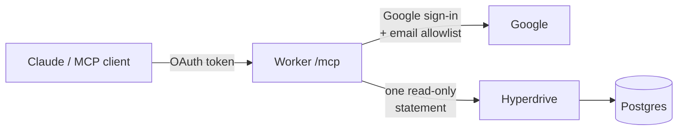

# readonly-postgres-mcp

Let Claude query your Postgres databases, read-only, from a server you own.

readonly-postgres-mcp is a remote [MCP](https://modelcontextprotocol.io)
server that runs on Cloudflare Workers. Add it to claude.ai (or any MCP client
that supports OAuth) as a custom connector, and Claude can answer questions
and build dashboards from live data through a connection that cannot write.

- **Read-only.** Every query runs in a read-only transaction that is always
  rolled back, one statement at a time.
- **Private.** Only the Google accounts you list can sign in, and the list is
  checked on every request.
- **Cheap to run.** Fits the Cloudflare free plan, with up to 10 databases.

## How it works



1. The client signs in with Google. The Worker only issues a token if the
   email is verified and in `ALLOWED_EMAILS`.
2. Each MCP call is checked against the allowlist again, then the SQL runs
   through Hyperdrive inside `BEGIN READ ONLY` … `ROLLBACK`.
3. Rows come back as JSON.

## Tools

| Tool | Input | Returns |
|------|-------|---------|
| `list_databases` | none | `{ databases: string[] }` |
| `execute_sql_readonly` | `{ database, sql }` | `{ rows, rowCount }` |

Each query is limited to one statement of up to 16,000 characters, a 10s
statement timeout and 5,000 result rows. Results come back both as JSON text
and as `structuredContent`.

## Setup

You need:

- a Cloudflare account (free plan is fine)
- a Google Cloud project, for the OAuth client
- Node.js 22 or newer
- a Postgres role that can read only what Claude should see (see
  [Database roles](#database-roles))

Below, `<your-subdomain>` is your `workers.dev` subdomain, so the server lives
at `https://readonly-postgres-mcp.<your-subdomain>.workers.dev`.

### 1. Install

```bash
git clone https://github.com/zahidakhyar/readonly-postgres-mcp.git
cd readonly-postgres-mcp
npm install
cp wrangler.example.jsonc wrangler.jsonc
npx wrangler kv namespace create readonly-postgres-mcp-oauth
```

Then edit `wrangler.jsonc` (it is gitignored, so your ids stay local):

| Field | Set it to |
|-------|-----------|
| `kv_namespaces[0].id` | the id printed by the last command |
| `vars.MCP_RESOURCE` | `https://readonly-postgres-mcp.<your-subdomain>.workers.dev/mcp` |

`MCP_RESOURCE` must be exactly the URL you will add as the connector.

### 2. Create a Google OAuth client

In Google Cloud Console, go to APIs & Services → Credentials → Create
credentials → OAuth client ID, choose **Web application**, and add these
authorized redirect URIs:

```
https://readonly-postgres-mcp.<your-subdomain>.workers.dev/callback
http://localhost:8788/callback
```

### 3. Set secrets and deploy

```bash
npx wrangler secret put GOOGLE_CLIENT_ID
npx wrangler secret put GOOGLE_CLIENT_SECRET
openssl rand -hex 32 | npx wrangler secret put COOKIE_ENCRYPTION_KEY
npx wrangler secret put ALLOWED_EMAILS
npm run deploy
```

| Secret | Value |
|--------|-------|
| `GOOGLE_CLIENT_ID`, `GOOGLE_CLIENT_SECRET` | from step 2 |
| `COOKIE_ENCRYPTION_KEY` | random; the command above generates one |
| `ALLOWED_EMAILS` | comma-separated Google emails, e.g. `alice@example.com,bob@example.com` |
| `HOSTED_DOMAIN` (optional) | a Google Workspace domain; the sign-in screen then only offers accounts from it. Access is still decided by `ALLOWED_EMAILS`. |

### 4. Add a database

```bash
npm run add-db -- <name> "postgres://<user>:<password>@<host>:5432/<db>"
```

This creates a Hyperdrive config named `<worker name>-<name>` (caching off),
adds an `HD_<NAME>` binding to `wrangler.jsonc`, and redeploys. Names use
lowercase letters, digits and `_`. The connection string never appears in
error output.

To remove one: `npm run remove-db -- <name>`.

### 5. Connect Claude

In claude.ai, open Settings → Connectors → Add custom connector and enter:

```
https://readonly-postgres-mcp.<your-subdomain>.workers.dev/mcp
```

Sign in with an allowed Google account, then ask Claude to call
`list_databases`.

## Database roles

The database role decides what Claude can see; the server's guards are a
backstop. Give each database its own role and grant only the columns you
need.

Run this **as the table owner**. A `REVOKE` run by any other role only prints
a warning and changes nothing, so do the check at the end:

```sql
REVOKE SELECT ON ALL TABLES IN SCHEMA public FROM <role>;
ALTER DEFAULT PRIVILEGES FOR ROLE <owner> REVOKE SELECT ON TABLES FROM <role>;
ALTER DEFAULT PRIVILEGES FOR ROLE <owner> IN SCHEMA public REVOKE SELECT ON TABLES FROM <role>;
GRANT SELECT (<columns>) ON <table> TO <role>;
```

Then, through the connector, this must return `false` for every sensitive
table:

```sql
SELECT has_table_privilege('<table>', 'SELECT');
```

## Security model

| Guard | What it does |
|-------|--------------|
| Google sign-in + allowlist | Only verified emails in `ALLOWED_EMAILS` get a token. The list is rechecked on every request, so removing an email locks that person out immediately. |
| Token audience | Tokens are bound to `MCP_RESOURCE` and are refused by any other server. The Google access token is used once to read the email and is not stored. |
| Read-only transaction | Each query runs in `BEGIN READ ONLY` and is always rolled back. A query cannot switch the transaction to read-write or lift its own timeout. |
| Single statement | The extended query protocol makes Postgres reject multiple statements. |
| Limits | 10s statement timeout, 5s connect timeout, 16,000-character SQL, 5,000 rows. |
| Logs | Query strings are redacted from Workers logs. |

To report a vulnerability, see [SECURITY.md](SECURITY.md).

## Troubleshooting

| Symptom | Fix |
|---------|-----|
| Sign-in fails with `invalid_target` | `MCP_RESOURCE` doesn't match the connector URL. Make them identical, then redeploy. |
| "This Google account is not allowed" | Add the email to `ALLOWED_EMAILS` (`npx wrangler secret put ALLOWED_EMAILS`). |
| `kv namespace create` says the title exists | Pick another title; any name works. |
| `Database "<name>" is unreachable` | Check the host, port and password in the Hyperdrive config (`npx wrangler hyperdrive get <id>`). |
| `Query failed: permission denied` | The role has no grant on that table or column. That's the role doing its job. |

## Development

```bash
cp .dev.vars.example .dev.vars   # fill it in; restart wrangler dev after edits
npm test
npm run type-check
```

| Task | Command |
|------|---------|
| Integration tests against real Postgres | `TEST_DATABASE_URL=postgres://... npx vitest run test/sql.integration.test.ts` |
| Run locally on `http://localhost:8788/mcp` | `CLOUDFLARE_HYPERDRIVE_LOCAL_CONNECTION_STRING_HD_<NAME>=postgres://... npx wrangler dev` |

## License

[MIT](LICENSE). The OAuth code is adapted from Cloudflare's
[remote-mcp-google-oauth](https://github.com/cloudflare/ai/tree/main/demos/remote-mcp-google-oauth)
template (MIT); see [THIRD_PARTY_NOTICES](THIRD_PARTY_NOTICES).
